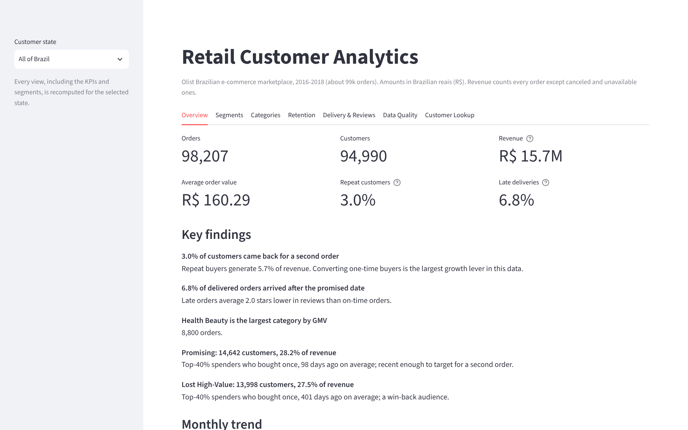
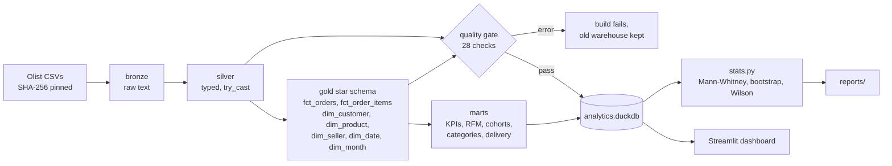
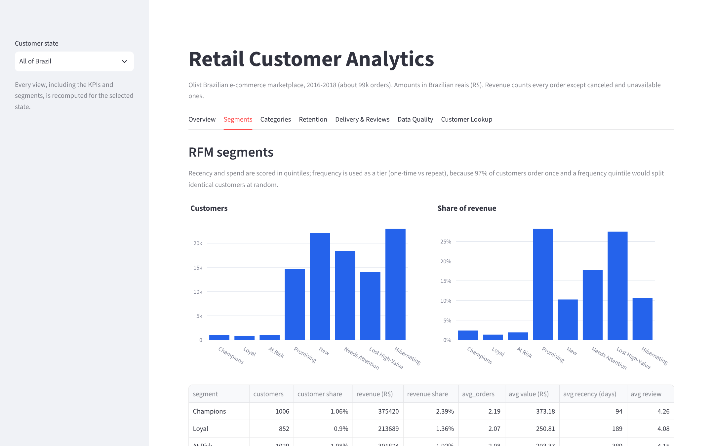
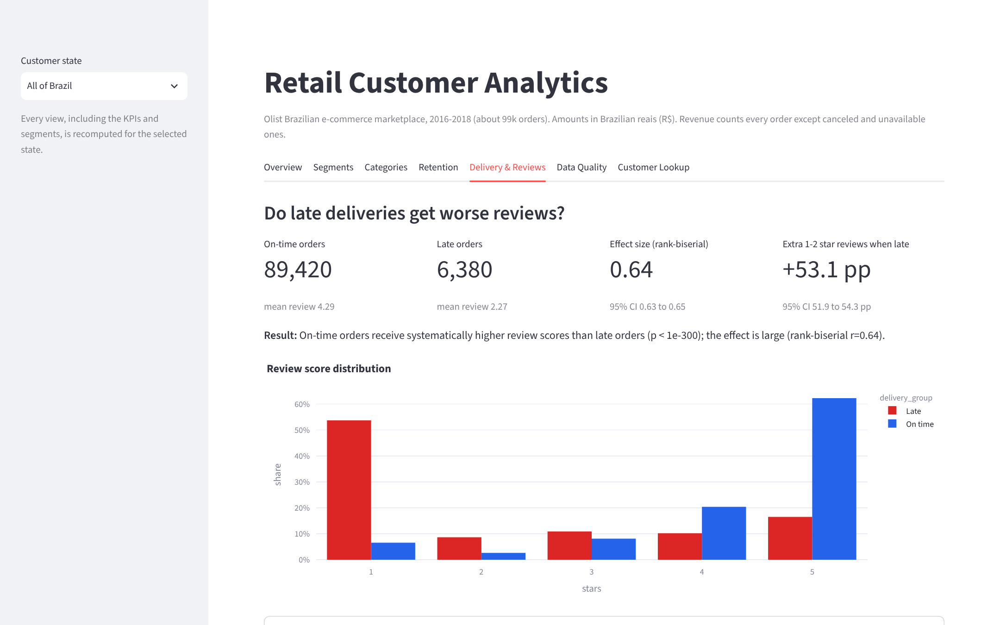
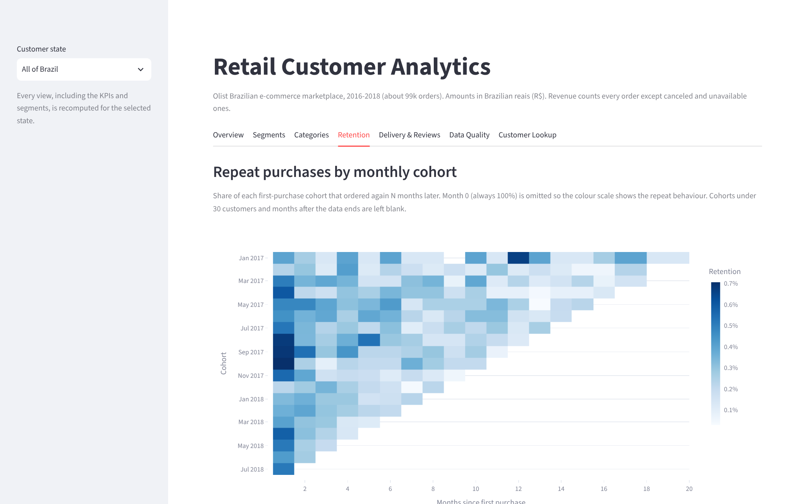
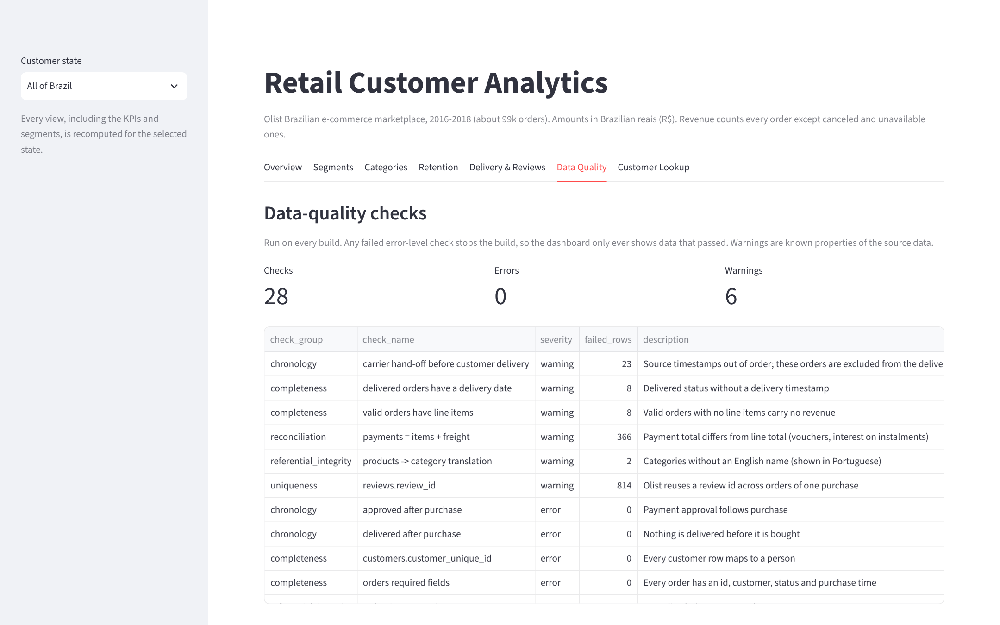

# Retail Customer Analytics

[](https://github.com/AtishayKashyap/Retail_Customer_Analytics/actions/workflows/ci.yml)

A customer analytics warehouse and dashboard for the [Olist Brazilian e-commerce dataset](https://github.com/olist/work-at-olist-data)
(about 99k orders, 2016-2018). Raw CSVs go through a DuckDB star schema with enforced data-quality checks into
RFM segments, cohort retention, category and state KPIs, and a statistical test of how late delivery affects reviews.

**Live dashboard:** https://retailcustomeranalytics.streamlit.app/



## What it answers

| Question | Answer (full results in [`reports/RESULTS.md`](reports/RESULTS.md)) |
|---|---|
| How many customers come back? | **3.0%** place a second order; they account for 5.7% of revenue |
| Where is the revenue? | Two one-time-buyer segments hold 56%: *Promising* (recent, top-40% spend) and *Lost High-Value* (same spend, gone 400+ days) |
| Does a late delivery cost reviews? | Yes, strongly. Late orders: mean 2.27 stars vs 4.29; 62% get 1-2 stars vs 9%. Rank-biserial r = 0.64 (95% CI 0.63-0.65), Mann-Whitney p < 1e-300 |
| How often is delivery late? | 6.8% of delivered orders, varying by state (4.5% in Sao Paulo) |
| Can the data be trusted? | 28 checks run on every build; any error-level failure stops the build |

Every figure is reproducible: `retail all` rebuilds the warehouse from checksum-pinned source files and regenerates
`reports/`, and CI fails if the committed reports differ from what the code produces.

## Pipeline



- **One definition of a valid order** (not canceled or unavailable), applied once in `fct_orders.is_valid` and used by
  every mart. National and per-state numbers come from the same `GROUPING SETS` query, so they always reconcile.
- **Atomic build.** The warehouse is written to a temporary file and only replaces the old one after every SQL step
  and every error-level quality check has passed. A file lock stops two app sessions building at once.
- **Quality gate.** Uniqueness, completeness, failed type conversions, referential integrity, value ranges,
  chronology and payment reconciliation. Known quirks of the source data (23 out-of-order carrier timestamps,
  366 payments that differ from the line total, 814 reused review ids) are warnings, documented and excluded where
  they would bias a result.

## Analytical choices

**RFM.** About 97% of customers order once, so a frequency quintile would split identical customers at random (the
previous version of this project did exactly that, and its "Loyal" segment averaged 1.01 orders). Frequency is used
as a tier (one-time vs repeat); recency and spend are quintiles with a deterministic tie-breaker. The eight segment
rules are in [`docs/METHODOLOGY.md`](docs/METHODOLOGY.md#rfm-segments).

**Late delivery** is decided on calendar dates. Olist stores the promised date as midnight, so comparing timestamps
marks a parcel delivered at 15:00 on the promised day as late; that error affected 1,280 orders before it was fixed.

**The review test** reports an effect size and confidence intervals, not just a p-value: with 96k orders any
difference is "significant". Caveats (observational data, review timing) are in the methodology.

| Segments | Delivery vs reviews |
|---|---|
|  |  |
| **Cohort retention** | **Data quality** |
|  |  |

## Run it

```bash
python -m venv .venv && source .venv/bin/activate   # Windows: .venv\Scripts\activate
pip install -r requirements.txt -e ".[dev]"
retail all                    # download (about 60 MB), build, write reports/  (~20 s)
streamlit run src/app.py
```

`retail fetch | build | report` run the steps separately. Paths can be changed with `RETAIL_RAW_DIR`,
`RETAIL_DB_PATH` and `RETAIL_REPORTS_DIR`. On Streamlit Community Cloud the app builds the warehouse itself on first
start.

## Tests

```bash
pytest --cov=retail_analytics      # 28 tests, 96% coverage
ruff check . && mypy               # lint, strict typing
```

The tests build a warehouse from a small synthetic dataset where every answer is known: a repeat high spender must be
a Champion, a one-time buyer never can be, canceled orders never count as revenue, a parcel delivered later on the
promised day is on time, RFM is identical across builds, and a duplicate order id, an orphan order line or an
unparseable price must fail the build and leave no database behind. The statistics are checked against reference
values and against data with no real difference.

## Layout

```
src/retail_analytics/
  sql/01_staging.sql   bronze and silver
  sql/02_model.sql     star schema
  sql/03_marts.sql     KPIs, RFM, cohorts, delivery
  sql/04_quality.sql   data-quality checks
  fetch.py build.py stats.py queries.py report.py cli.py
src/app.py             Streamlit dashboard
reports/               generated results (checked in CI)
docs/                  methodology, data model
tests/
```

## Data

Olist Store, *Brazilian E-Commerce Public Dataset*, released under CC BY-NC-SA 4.0. Amounts are Brazilian reais (R$).
Code in this repository is MIT licensed.
